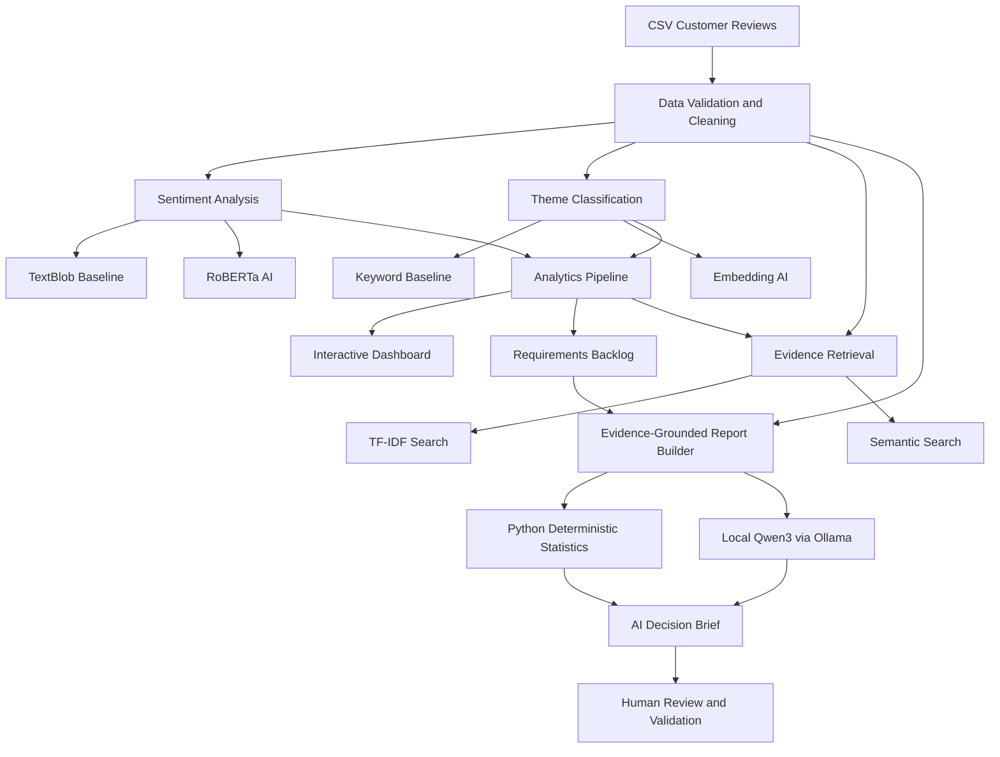

# Voice2Roadmap AI

### Evidence-Grounded Product Intelligence & AI-Assisted Requirements Management

Voice2Roadmap AI is an interactive product intelligence application that transforms unstructured customer feedback into sentiment insights, issue themes, prioritized product requirements, traceable evidence, and AI-assisted decision reports.

Built with **Python, Streamlit, RoBERTa, Sentence Transformers, and a locally hosted Qwen3 LLM**, the project demonstrates an end-to-end workflow from customer feedback to product decision support.

**Status:** Functional portfolio MVP
**Interface:** Streamlit
**AI inference:** Local / experimental
**Live demo:** [Launch Voice2Roadmap AI](https://voice2roadmap-ai-gqr.streamlit.app)
**Deployment note:** The public demo supports dashboard analytics, RoBERTa sentiment analysis, and embedding-based classification and retrieval. Qwen3 decision brief generation requires local Ollama and is disabled in the cloud deployment.

> **Data transparency:** The bundled demonstration reviews are synthetic. User-uploaded datasets may have different provenance and licensing conditions. Model outputs and proposed requirements require human validation.

---

## 1. Project Motivation

Product teams receive large amounts of unstructured customer feedback through app reviews, support tickets, and other channels.

However, translating this feedback into actionable product requirements remains challenging.

Typical challenges include:

- Identifying recurring customer problems
- Understanding negative sentiment and issue severity
- Finding relevant original evidence
- Prioritizing product improvement opportunities
- Converting feedback into testable requirements
- Communicating findings to product stakeholders

Voice2Roadmap AI connects these activities in one workflow.

The application is intended as a **decision-support prototype**, not an autonomous product management system.

---

## 2. Key Features

### Customer Feedback Processing

- CSV upload and validation
- Review text normalization
- Optional review metadata: product, date, rating, and review ID
- Duplicate handling and evidence traceability
- Synthetic demonstration dataset for reproducible exploration

### Sentiment Analysis

Two selectable approaches:

1. **TextBlob baseline**
   - Lightweight lexicon-based sentiment classification
   - Transparent baseline for comparison

2. **RoBERTa AI (experimental)**
   - Transformer-based English sentiment classification
   - Model: `cardiffnlp/twitter-roberta-base-sentiment-latest`
   - Predictions: Positive, Neutral, Negative

The RoBERTa model runs locally after its model files are downloaded.

### Theme Classification

Two selectable approaches:

1. **Keyword baseline**
   - Transparent keyword-based issue labeling

2. **Embedding AI (experimental)**
   - Sentence Transformers-based semantic similarity
   - Assigns reviews to predefined product issue themes
   - Includes an Other / General category for uncertain matches

Example themes include:

- Performance
- Login & Access
- Usability & Design
- Connectivity & Integration
- Notifications
- Payments & Pricing
- Content & Data
- Accessibility

Theme predictions are experimental and may require manual correction.

### Interactive Dashboard

- Total customer feedback analyzed
- Positive and negative sentiment proportions
- Average review rating
- Customer issue distribution
- Negative-feedback trends when dates are available
- Product and sentiment filters

### Requirements Backlog

Automatically produces draft requirements using:

- Theme frequency
- Negative sentiment share
- A transparent prioritization heuristic
- Proposed requirement descriptions
- Example acceptance criteria
- Supporting customer review IDs

Every generated requirement is marked for human review.

### Evidence Explorer

Supports:

- TF-IDF baseline retrieval
- Embedding-based semantic retrieval
- Original customer review inspection
- Review IDs and relevance scores

This allows analysts to trace suggested improvements back to specific feedback.

### Local AI Decision Brief

Uses **Qwen3 4B through Ollama** to generate qualitative product recommendations.

The report includes:

1. Executive Summary
2. Top Customer Pain Points
3. Product Improvement Recommendations
4. Proposed Product Requirements
5. Acceptance Criteria
6. Risks and Next Steps

The reporting architecture separates deterministic analysis from generative AI.

**Python is responsible for:**

- Review counts
- Sentiment percentages
- Priority scores
- Requirement IDs
- Supporting evidence references
- Draft acceptance criteria

**Qwen3 is responsible for:**

- Qualitative product improvement suggestions

This design reduces the risk of inconsistent statistics and invented quantitative targets in LLM-generated reports.

It does not eliminate hallucinations or guarantee that every recommendation is appropriate.

### Export

- Analyzed reviews as CSV
- Prioritized requirements backlog as CSV
- AI decision brief as Markdown

---

## 3. System Architecture



---

## 4. Technology Stack

| Component | Technology |
| --- | --- |
| Programming language | Python |
| Web application | Streamlit |
| Data processing | Pandas |
| Visualization | Plotly |
| Baseline sentiment | TextBlob |
| Transformer sentiment | Hugging Face RoBERTa |
| Semantic classification | Sentence Transformers |
| Baseline retrieval | Scikit-learn TF-IDF |
| Semantic retrieval | Sentence embeddings |
| Local language model | Qwen3 4B |
| LLM runtime | Ollama |
| LLM client integration | OpenAI-compatible API |
| Automated testing | Pytest |

The OpenAI Python package is used to communicate with the local Ollama-compatible endpoint. The active local Qwen3 workflow does not require a paid OpenAI API key.

---

## 5. Getting Started

### Prerequisites

- Python 3.12 recommended
- Git
- Ollama for optional local AI reports
- Sufficient memory for local transformer and LLM inference

### Clone the Repository

After the repository is published:

```bash
git clone https://github.com/YOUR_USERNAME/voice2roadmap-ai.git
cd voice2roadmap-ai
```

Replace `YOUR_USERNAME` with the actual GitHub username.

### Create a Virtual Environment

```bash
python3 -m venv .venv
source .venv/bin/activate
```

For Windows, use the appropriate activation command for your terminal.

### Install Dependencies

```bash
python -m pip install -r requirements.txt
```

Some transformer models are downloaded automatically on first use.

### Run the Application

```bash
python -m streamlit run app.py
```

Open the local address displayed in the terminal, typically:

`http://localhost:8501`

The built-in synthetic dataset can be explored without Ollama.

---

## 6. Optional Local Qwen3 Setup

To use AI Decision Brief, install and start Ollama.

Official website:

https://ollama.com/

Download the model:

```bash
ollama pull qwen3:4b-instruct
```

Ensure Ollama is running. On systems where it is not already running as a background service:

```bash
ollama serve
```

Start the Streamlit application in a separate terminal.

Then open the **AI Decision Brief** tab and generate a report.

The application connects to the local Ollama endpoint:

`http://127.0.0.1:11434/v1`

**No paid API key is required for the local Qwen3 workflow.**

The local AI feature requires Ollama and the configured model to be available on the machine running the application.

---

## 7. CSV Input Format

Required column:

- `review`

Supported aliases may include `content`, `text`, and `review_text`.

Optional columns:

| Column | Example |
| --- | --- |
| review_id | REV-001 |
| date | 2026-08-15 |
| product | Sample App |
| rating | 2 |
| review | The app crashes during login. |

A synthetic dataset is included:

`data/demo_reviews.csv`

Missing dates and ratings are supported.

---

## 8. Requirements Prioritization

Voice2Roadmap AI uses a transparent heuristic:

```text
reach_proxy = theme_mentions / total_selected_reviews

negative_share = negative_reviews_in_theme / theme_mentions

signal_score = 100 * (
    0.45 * min(1.0, reach_proxy * 5)
    + 0.55 * negative_share
)
```

The signal score is a prioritization aid.

It is **not**:

- A validated customer impact score
- A RICE score
- A financial return estimate
- A measurement of total customer reach

A product owner should validate requirements using product analytics, interviews, usability testing, and additional evidence.

---

## 9. Model Experiments and Evaluation

The project includes exploratory comparisons between baseline NLP techniques and transformer or embedding-based approaches.

### Sentiment Model Comparison

A local experiment analyzed 1,948 English-language reviews.

| Predicted Sentiment | TextBlob | RoBERTa |
| --- | ---: | ---: |
| Positive | 908 | 555 |
| Neutral | 564 | 172 |
| Negative | 476 | 1,221 |

Agreement between the two prediction sets was approximately **51.4%**.

These results show substantial differences between model predictions.

They do **not** establish which model is more accurate, because no independently validated human-labeled sentiment test set was used.

Star ratings provide only an imperfect reference signal.

### Theme Classification Comparison

Keyword and embedding-based theme predictions were also compared.

An exploratory 60-review comparison using AI-assisted reference labels indicated differing agreement rates between methods.

However, AI-assisted reference labels are not human-verified ground truth.

No definitive theme classification accuracy should be inferred from this comparison.

### Retrieval Evaluation

TF-IDF and embedding search can both retrieve supporting customer reviews.

Qualitative examples demonstrate the search workflow, but a formal retrieval benchmark with relevance judgments is still needed.

See:

`docs/EVALUATION.md`

---

## 10. Data Ethics and Limitations

### Synthetic Demonstration Data

The bundled demo CSV contains fictional customer reviews created for portfolio testing.

Synthetic examples must not be presented as actual customer evidence.

### User-Uploaded Data

Users may upload separately sourced review datasets.

The application does not independently verify original provenance or redistribution rights.

Reviews from multiple unrelated applications should not be interpreted as feedback about a single product.

### AI Limitations

- Sentiment classification can misinterpret context, sarcasm, or ambiguous language.
- Theme classification can assign incorrect labels.
- Embedding similarity is not a calibrated probability.
- Evidence retrieval may return irrelevant matches or miss relevant reviews.
- AI-generated recommendations may contain unsupported assumptions.
- Automated requirements require product-specific validation.
- Review frequencies are not representative measures of an entire customer population.

Customer review text is treated as untrusted input in the AI reporting workflow.

Do not upload confidential or personally identifiable feedback without appropriate authorization.

---

## 11. Testing

Install Pytest if necessary:

```bash
python -m pip install pytest
```

Run:

```bash
python -m pytest -q
```

The existing tests focus on core data processing and analysis behavior. Additional tests for experimental AI components remain future work.

---

## 12. Deployment Limitations

The application is designed primarily for local execution.

The current AI reporting feature connects to Ollama at:

`127.0.0.1:11434`

A public Streamlit deployment cannot automatically access Ollama running on a developer's personal computer.

Public deployment therefore requires a separate inference architecture or a version that disables local-only features.

A fully hosted AI deployment has not yet been implemented.

---

## 13. Project Structure

```text
voice2roadmap-ai/
├── app.py
├── src/
│   ├── pipeline.py
│   ├── analytics.py
│   ├── retrieval.py
│   ├── semantic_classifier.py
│   ├── semantic_retrieval.py
│   ├── local_ai.py
│   └── ai.py
├── data/
│   └── demo_reviews.csv
├── scripts/
├── docs/
├── tests/
├── .github/
├── .streamlit/
├── requirements.txt
├── README.md
├── .env.example
├── .gitignore
└── LICENSE
```

Additional experimental datasets and model comparison outputs may exist in the local development environment but are excluded from the public repository pending data licensing review.

---

## 14. Future Improvements

- Human-annotated benchmark for sentiment and theme evaluation
- Quantitative semantic retrieval evaluation
- Multi-label aspect classification
- Improved AI recommendation grounding
- Interactive human approval workflow
- Jira-compatible requirements export
- Scalable hosted inference architecture
- Historical trend monitoring
- Additional automated regression tests

---

## 15. Portfolio Summary

**Voice2Roadmap AI** demonstrates practical applications of machine learning, local LLMs, product analytics, and systems engineering.

The project integrates:

- Transformer-based sentiment analysis
- Embedding-based classification and retrieval
- Evidence-linked requirement generation
- Deterministic analytics
- Local LLM-assisted product recommendations
- Interactive decision-support dashboards

Its main contribution is connecting customer feedback to traceable, reviewable product requirements rather than producing sentiment summaries alone.

---

## License

MIT License. See [LICENSE](LICENSE).

The bundled synthetic demo dataset is intended for demonstration and testing.
